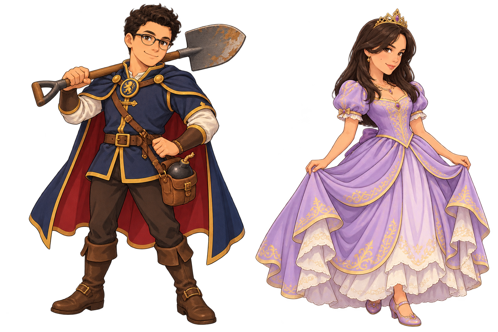
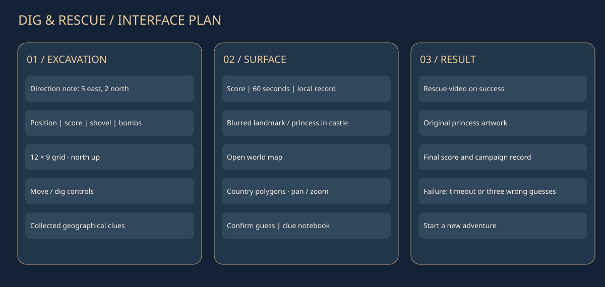

# Dig & Rescue

**Yağmur Akgül · GMT458 — Web GIS · Hacettepe University**

[Play the game](https://yagmurakgul.github.io/geogame-dig-and-rescue/)

## About the game

Dig & Rescue is a browser game about a prince searching for a princess hidden in a distant castle. I wanted to combine a rescue story with geography, so the player has to dig through tunnels, collect geographical clues and identify countries on a world map.

Not every tunnel leads to the princess. Sometimes the prince reaches a different country and sees a blurred photograph of a landmark. Identifying that country correctly earns a bomb, which can be used during the next excavation. At the final castle, the player uses the collected notes to work out where the princess is.

The final country is fixed in this version to match the ending animation. I have left its name out of the description to avoid giving away the answer.



## Game requirements

The main requirements I used while developing the game were:

- A digging area where the player can move, use a shovel and place bombs.
- Direction instructions and grid references that help the player find a hidden passage.
- Collectible notes containing geographical clues about the final destination.
- Landmark photographs and a world map with selectable country boundaries.
- A time limit, a scoring system and saved high scores.
- Keyboard controls and on-screen controls for touch input.
- Opening and ending animations using the game's characters.

The digging area is a **12 × 9 grid**. Columns are labelled A–L and rows 1–9. Each cell represents 10 × 10 metres in the fictional excavation plan. The player follows cardinal directions, such as east and north, to locate the passage. This grid is a local game map, not a real tunnel between countries.

The world-map stages use actual country polygons. Together with the direction tasks, landmark recognition and geographical clues, this makes geography part of the gameplay rather than just its background.

## Frontend layout



The sketch shows the three main parts of the interface:

1. **Excavation:** a direction note above the grid, position and equipment information, movement buttons and a notebook for collected clues.
2. **Surface visit:** a landmark photograph followed by a world-map view. The player can pan, zoom, select a country and confirm a guess. The score and timer remain visible.
3. **Result:** the rescue or failure message, final score, high score and a button to start again.

A language selector at the top switches the interface between Turkish and English. The videos keep their original audio and embedded text. When a video finishes, a closing message stays on screen until the player chooses to continue.

## Progression and number of tasks

One game contains **3–5 excavation stages and 3–5 country-selection tasks**, depending on when the final passage is reached. Earlier surface destinations are selected from a pool of ten countries. A shuffled queue reduces repeated destinations between games when local storage is available.

The starting position, hidden passage and direction instructions change between excavations. Soil needs three shovel hits to break. A bomb clears a 3 × 3 area, which makes it useful when the player wants to open several cells at once.

There are **four geographical clues** about the final destination. Up to two remaining clues are placed in each excavation. The player collects a note by walking onto its revealed cell. These clues are a fixed set in the current version.

There are no separate easy, medium and hard levels yet. Progression comes from moving between excavation and country challenges, collecting information, and finally combining that information at the castle.

## Time limit and guesses

Digging has no time limit. For each surface visit, a **60-second countdown** starts when the world map first loads successfully. This gives the player time to examine the photograph before opening the map. After the countdown starts, returning to the photograph or switching tabs does not pause it.

Regular country tasks allow **one guess**. A wrong answer or timeout gives no reward, but the player can return underground and continue.

The final task allows **three guesses within the same 60 seconds**. The timer does not restart after a wrong guess. Running out of time or using all three guesses ends the game. A correct answer rescues the princess and starts the ending sequence.

## Scoring and high scores

| Result | Points and reward |
| --- | --- |
| Correct regular answer | 100 + 2 × displayed seconds remaining, and one bomb |
| Wrong regular answer or timeout | No points or bomb |
| Correct final answer | 300 + 2 × displayed seconds remaining |
| Final failure | The game ends with the points already earned |

The time bonus rewards quicker answers. High scores are saved when a game ends, using `localStorage`. Games with different numbers of stages have separate records. Scores are stored in the current browser; they do not transfer to another browser or device.

## Controls

| Input | Action |
| --- | --- |
| WASD / arrow keys | Turn or move |
| Space | Use the selected tool |
| 1 / 2 | Select shovel / bomb |
| Click or tap an adjacent cell | Dig, move or place a bomb |
| Click or tap a distant cell | Mark a target |
| On-screen direction and action buttons | Move and use tools on touchscreens |
| Drag the map | Pan |
| + / − buttons | Zoom |

## Technologies and geographical data

The game uses **HTML, CSS and JavaScript**. Excavation and the world map are drawn with the browser's Canvas 2D API. Other browser features used include Pointer Events, Web Audio, HTML video and `localStorage`.

There are currently **no external JavaScript library dependencies**. The map is rendered directly from GeoJSON rather than through Leaflet or OpenLayers. Country selection uses Canvas `isPointInPath`; the map is displayed with a simple equirectangular projection.

Country boundaries come from [datasets/geo-countries](https://github.com/datasets/geo-countries), which distributes [Natural Earth](https://www.naturalearthdata.com/) data. The downloaded boundaries are stored as `assets/countries.geojson`. ISO country codes are used to compare the selected polygon with the correct answer.

Landmark photographs, character artwork and videos are separate assets. Original photograph sources and licence details still need to be added to the project credits.

## Three event handlers

### 1. Keyboard input — `game.js`

A `keydown` listener handles the movement keys and Space. It changes the direction of the character, moves into an open cell or uses the selected tool. It ignores input from form controls so that using the language selector does not move the character.

### 2. Map selection — `surface.js`

A `pointerup` listener checks whether the player tapped the map or dragged it. For a tap, the pointer position is converted to canvas coordinates and checked against country polygons. The selected country is then shown in the confirmation message.

### 3. Confirming a guess — `surface.js`

The confirmation button's `click` listener checks the remaining time and compares the selected country's ISO3 code with the answer. It updates the score and bomb inventory after a correct regular answer. At the castle, it either subtracts a guess or opens the rescue sequence.

## How I used closures

The scripts are organised inside immediately invoked function expressions (IIFEs). Event listeners can still access variables defined in these functions after setup has finished.

For example, the country-confirmation callback uses `selectedCountry`, `score`, `lives` and `answered` from its surrounding scope. The timer callback also keeps access to `deadline`. This lets the callbacks share the state they need without making every variable global.

## DOM interaction

I use `getElementById` and `querySelector` to find controls and scene elements. Surface screens and notebook entries are created with `createElement` and added to the page with `appendChild`.

Messages, clue text and counters are updated through `textContent`. The `hidden` property controls which scene is visible, while `classList` controls effects such as photograph blur and transitions. The game grid and country polygons are drawn inside canvas elements rather than created as individual HTML elements.

## What I learned from AI

I used ChatGPT during development to discuss design choices, develop code and troubleshoot issues. Working through these changes helped me understand event handlers, closures and DOM updates, as well as how pointer positions are converted into map coordinates. Debugging missing assets also taught me to check file paths and names carefully.

[Follow-up code review and learning discussion](https://chatgpt.com/share/6b031a82-e084-83ed-8b64-f7826d59b643)

## Running the project

The main files are:

| File | Purpose |
| --- | --- |
| `index.html` | Page structure and main controls |
| `style.css` | Layout and styling |
| `game.js` | Digging, movement, routes, tools and clues |
| `surface.js` | Country challenges, map, timer and scoring |
| `cinematics.js` | Videos and closing transitions |
| `i18n.js` | Interface translations |

Keep these files at the project root, alongside the `assets` and `docs` folders. The character image is stored at `assets/characters/characters.png`, and the two videos at `assets/videos/intro.mp4` and `assets/videos/ending.mp4`. Landmark photographs belong in `assets/landmarks`.

Open the project using VS Code Live Server, or run the following command from the project folder:

```bash
python3 -m http.server 8000
```

Then open [localhost:8000](http://localhost:8000). A local HTTP server is needed for loading the GeoJSON file. To play from another device, use the published GitHub Pages address at the top of this README.

## Current status and next steps

The game is still being developed. The current version includes the digging and country-selection loop, randomised excavation routes, a fixed final destination, Turkish/English interface text, scoring and cinematic transitions.

My next priorities are to test complete playthroughs on phones and different browsers, check every asset on the published site, and improve readability and controls where needed. Touch controls are included, but broad mobile and cross-browser compatibility has not yet been fully verified.

A discovery passport, randomised clue pool and changing final countries have not been added. Further features will be considered after the existing version has been tested more thoroughly.

Before submission, I still need to complete media credits, check that the linked AI discussion is accessible, check the live demo link and register the repository in the course peer-review system. Git commits will be used to track further changes as development continues.
